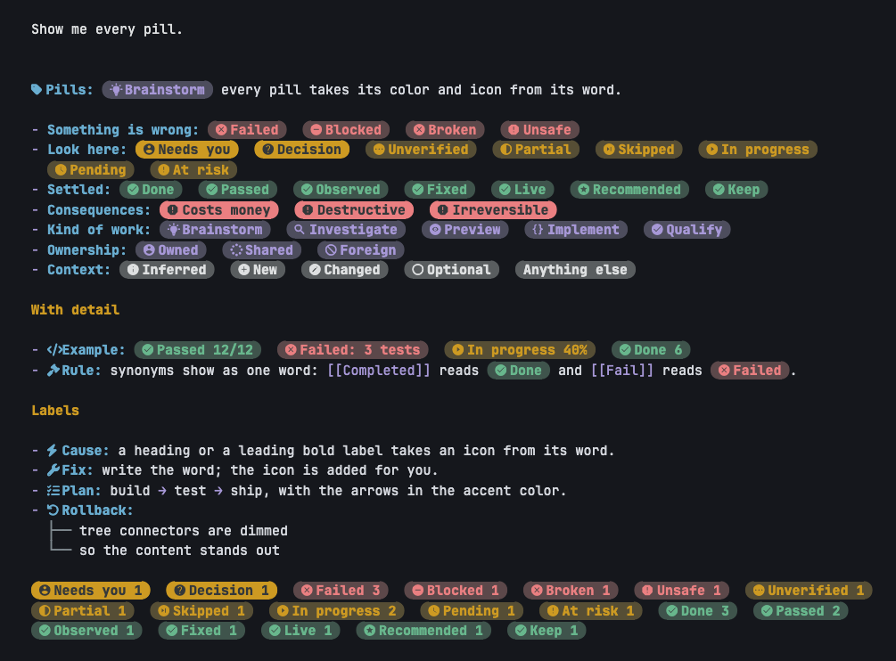

# Pi Emphasis

## This fork

This is a fork of [pi-emphasis](https://github.com/johnlindquist/pi-emphasis) by John Lindquist, at commit `f884b73`. The drawing code (pills, labels, lead-ins, marks, trees) comes from upstream. The fork differs in four ways:

- **Compact rules.** The `reply_style` prompt section is a short tested rule set of 310 tokens, in place of upstream's guidance of 2,419 tokens. Both counts are the extra provider input tokens that the text adds to a request on claude-opus-5-5. Upstream's own README says its guidance adds about 1,500 tokens, an estimate with no stated method. In a test with the same prompts, it gave the same reply shape as upstream's guidance: a kind-of-work pill, `##` sections, and a pill right after each subject. The rules are the `REPLY_STYLE` constant in [`index.ts`](index.ts).
- **A new look.** Pill colors come from the current pi theme. All icons are circles of one size. Needs you and Decision are solid yellow, so they stand apart from status pills. A count line of the reply's pills appears after its last block when the reply is complete. [DESIGN.md](DESIGN.md) records each decision.
- **Settings.** An optional `emphasis` block in pi's `settings.json` sets the pill ends, the icons, the label color, and the color and fill of each tone. See [Settings](#settings).
- **No environment switches.** The four `PI_EMPHASIS_*` environment variables are gone. The rules are always on in the terminal interface.

What is rewritten and what is upstream's: the compact rules, the new look, the settings, the removal of the environment switches, the block reader (`reader.ts`), the count line and the streaming cache are this fork's. The original renderer (pills, labels, bold and glyph colors) and the rest of this README come from upstream, corrected where the fork makes it false. Upstream's MIT notice stays in [LICENSE](LICENSE). To merge upstream changes, see [Development](#development).

Replies you can scan. This [Pi](https://pi.dev/) extension turns `[[Done]]`, `[[Failed]]` and `[[Needs you]]` into colored pills with icons, gives headings and lead labels an icon from their word, and colors bold text, arrows and tree lines.


The reply above is an invented example about an imagined deploy. This is the same reply without the extension:


It changes only what is drawn. Stored messages, copied text and HTML exports keep the original Markdown. It makes no extra model call. The `reply_style` prompt section does add input tokens to each model request in the terminal interface: see [The rules come with it](#the-rules-come-with-it).

## Requirements

| You need | Why | Without it |
|---|---|---|
| [Pi](https://github.com/earendil-works/pi) 1.5.1 or newer, below 2 (tested on 1.5.2) | This is a Pi extension | Unsupported. An older Pi may load it without honoring the assistant-only registration filter |
| A terminal that can draw [Nerd Font](https://www.nerdfonts.com/) symbols | The icons and the rounded pill ends are Nerd Font symbols | You see empty boxes or question marks. See [Set up your terminal](#set-up-your-terminal) |
| A terminal with color | Pills are colored backgrounds | Pills are drawn in reverse video, all in one color |

Checked on macOS only. Setup takes about two minutes if your terminal already has the symbols.

## Install

Git must be installed. Install from this repository:

```sh
pi install git:github.com/FasalZein/pi-emphasis
```

Then run `/reload` in Pi, or start Pi again.

- Update: `pi update git:github.com/FasalZein/pi-emphasis`
- Try once without installing: `pi -e git:github.com/FasalZein/pi-emphasis`
- Remove: `pi remove git:github.com/FasalZein/pi-emphasis`

Alternative, from a local checkout: clone the repository, then run `pi install /path/to/pi-emphasis`. Update it with `git pull` and `/reload`. Try it once with `pi -e /path/to/pi-emphasis`. Remove it with `pi remove /path/to/pi-emphasis`.

## Set up your terminal

**1. Check whether your terminal already draws the symbols.** Paste this into your shell:

```sh
printf '\ue0b6\U000f05e0 \U000f02d7 \U000f0009\ue0b4\n'
```

You should see a half circle, a check mark in a circle, a question mark in a circle, a person in a circle and another half circle. If you do, skip to step 3. Ghostty, kitty and WezTerm include these symbols, so they usually pass with any font.

**2. If you see boxes, install a Nerd Font and select it.** On macOS with Homebrew:

```sh
brew install --cask font-jetbrains-mono-nerd-font
```

Or download any family from [nerdfonts.com](https://www.nerdfonts.com/font-downloads). Then choose it as the terminal's font and run the check again:

| Terminal | Where the font is set |
|---|---|
| iTerm2 | Settings, Profiles, Text, Font |
| macOS Terminal | Settings, Profiles, Text, Font |
| VS Code terminal | the `terminal.integrated.fontFamily` setting, for example `JetBrainsMono Nerd Font` |
| Alacritty | `font.normal.family` in `alacritty.toml` |

To keep your current font, install only the symbols with `brew install --cask font-symbols-only-nerd-font` and add "Symbols Nerd Font" as a fallback font where your terminal supports one.

**3. Check it in Pi.** After installing the extension and running `/reload`, ask:

> Reply with one line that uses the pills [[Done]], [[Needs you]], [[Failed]] and [[Costs money]].

You should see four rounded pills, each with an icon: Done on a green panel, Needs you in solid yellow, Failed on a red panel and Costs money in solid red.

**No Nerd Font?** Set `"icons": "none"` and `"edges": "half"` or `"sharp"` in the `emphasis` settings ([Settings](#settings)). Half blocks are standard Unicode characters, so every terminal font draws them. This covers pills only: heading labels, lead labels and action lead-ins keep their icon glyphs.

## The rules come with it

An agent writes pills only when it is told how. In Pi's terminal interface the extension adds a `reply_style` section to the system prompt on every run, so there is nothing to paste into an `AGENTS.md`. The section tells the agent:

- to open with **Result:**
- to open a long reply with a kind-of-work pill (Brainstorm, Investigate, Preview, Implement or Qualify) before **Result:**, to give it a `##` heading per group, and to write each bullet as **Subject** [[Pill]] text
- to use these pill words: Done, Passed, Fixed, Observed, Recommended, Failed, Blocked, Partial, In progress, Unverified, At risk, Needs you, Decision, Destructive, Costs money, Shared
- to follow a pill with the step that resolves it, led by a bold Do:, Check:, Next:, Unblock:, Left:, Guard:, Undo: or See:
- to put Costs money or Destructive once, before an action that waits for your approval, and to mention a cost only there or when it passes the amount you approved

The section is fixed text. A test checks that every kind, pill word and lead-in it names gets its color and icon, so the rules and the drawing cannot drift apart. It adds 310 tokens to the prompt, measured on claude-opus-5-5 (188 by tiktoken o200k_base). Print, JSON and RPC runs do not get the section, since nothing there draws pills.

## Pills

Write `[[Word]]` beside the thing it describes. The word decides the color and the icon.



| Color (default) | Tone | Meaning | Words |
|---|---|---|---|
| Red panel | error | Something is wrong | Failed, Blocked, Broken, Unsafe, Rejected, Down |
| Solid yellow | ask | Only you can act | Needs you, Decision |
| Yellow panel | warning | Look here | Unverified, Partial, Skipped, In progress, Pending, At risk, Review, Todo, Stale, Draft |
| Green panel | success | Settled | Done, Passed, Observed, Fixed, Live, Recommended, Keep, Ready, Merged, Safe, Verified, Shipped, Approved, Healthy |
| Solid red | danger | Consequences | Costs money, Destructive, Irreversible |
| Accent panel | mode | Kind of work | Brainstorm, Investigate, Preview, Implement, Qualify |
| Purple panel | owner | Ownership | Owned, Shared, Foreign |
| Grey panel | neutral | Context | Inferred, New, Changed, Optional, and any other label |

The colors come from the current pi theme, so a theme chosen with the Theme selector of `/settings` recolors the pills. [Settings](#settings) explains how to change the color, fill, ends and icons.

- **Detail.** A known word may be followed by detail: `[[Passed 12/12]]`, `[[Failed: 3 tests]]`, `[[In progress 40%]]`.
- **Synonyms.** Completed, Complete, OK and Finished display as Done. Fail, Failing and Error display as Failed. Pass displays as Passed, Waiting as Pending, and Needs review as Review.
- **Your own icon.** A label that starts with a Nerd Font glyph keeps that glyph.
- **Length.** A label can be up to 32 characters. Longer ones are left as typed.
- **Count line.** When a reply has 5 or more state pills of at least 2 words, a line after its last block shows one pill per word with its count, asks first: [[Needs you 1]] [[Partial 1]] [[Done 4]]. The line appears when the reply is complete, so nothing above it moves. A reply that already has a line of two or more pills and no other text gets no count line. Pills in code, inline code and HTML comments are not drawn and not counted. Pi hands the extension each text block of a message on its own, so the count line counts the pills of one text block: a message with text before and after a tool call can show two count lines, or none.

## Labels and shapes

- **Headings and lead labels.** A `##` heading, or bold text at the start of a line or list item (also after a kind-of-work pill), takes an icon when it is one of: Finding, Result, Status, Evidence, Cause, Effect, Fix, Risk, Limits, Cost, Decision, Options, Plan, Next, Why, How, Rule, Example, Checked, Verdict, Rollback, Undo, Review, Scoreboard, Terminal, Folder, File, Branch, Ideas, Pills, Colors, Icons. A trailing colon is fine.
- **Action lead-ins.** Bold **Check:**, **Do:**, **Next:**, **Unblock:**, **Left:**, **Run:**, **Guard:**, **Undo:** and **See:** take an icon anywhere in a line, so the action that follows a pill is easy to find: `[[Unverified]] the red pills on your screen. **Check:** run /reload.` The colon is required. An en space joins every label and lead-in icon to its word, so pi never leaves the icon alone at the end of a row.
- **While a reply streams.** An unfinished pill (`[[Wor`), an opening bold marker at the end (`**Resu`, `__Resu`) and the last line when it is a heading wait until they are complete, so they appear whole instead of as raw marks that jump. Only the end of the reply waits; code, math and HTML are never held back. The complete reply shows everything as written.
- **Bold.** `**anchor term**` keeps its weight and takes the label color: the theme's link color `mdLink` (blue in tokyonight), or the color in the `labels` setting.
- **Marks.** `✓` takes the success color, `✗` the error color, and `→` the accent color.
- **Trees.** `├──` and `└──` are dimmed so the content stands out.

Your own messages, inline code, fenced code and escaped asterisks are left alone. A `$` before a digit is drawn escaped, because pi's Markdown reads `$` as the start of LaTeX math and then prints the rest of the line as typed.

## Settings

The extension reads an optional `emphasis` block from pi's settings. Pi merges the global file `~/.pi/agent/settings.json` with the project file `.pi/settings.json`, and the extension reads the merged result. A field that is missing or not valid takes its default. A color name that the current pi theme does not know as a foreground color, such as `"teal"` or the background color `"toolPendingBg"`, also takes its default: use `#rrggbb` for a color outside the theme. After you change the block, run `/reload` in pi.

### Example

This block sets every field to its default:

```json
{
  "emphasis": {
    "edges": "round",
    "icons": "filled",
    "labels": "mdLink",
    "colors": {
      "success": "success",
      "error": "error",
      "warning": "warning",
      "ask": "warning",
      "danger": "error",
      "mode": "accent",
      "owner": "customMessageLabel",
      "neutral": "text"
    },
    "fill": {
      "success": "panel",
      "error": "panel",
      "warning": "panel",
      "ask": "solid",
      "danger": "solid",
      "mode": "panel",
      "owner": "panel",
      "neutral": "panel"
    }
  }
}
```

You only write the fields that you change. For example, this block gives the pills square ends and outline icons:

```json
{ "emphasis": { "edges": "sharp", "icons": "outline" } }
```

### Fields

#### edges

The shape of the two ends of a pill.

| Value | Ends | Width of each end |
|---|---|---|
| `round` (default) | Rounded Powerline caps | 1 cell |
| `half` | Square, from half-block characters | Half a cell |
| `sharp` | Square, one filled space | 1 cell |

A terminal draws whole cells. A rounded end narrower than one cell does not exist as a character, so `half` is square.

#### icons

The icon in front of the pill word.

| Value | Icons |
|---|---|
| `filled` (default) | Solid Material Design circles |
| `outline` | The same circles, drawn as rings |
| `none` | No icons |

All icons of a set have the same size: in a Nerd Font Mono font, each one measures 599 × 600 font units and is centred on the height of a capital letter.

An en space (U+2002) follows each icon. Ghostty lets a Nerd Font icon draw over two cells when a space or an en space follows it, so with a non-Mono Nerd Font the icon is about as tall as the letters and the pill keeps its width. pi breaks lines only at a normal space, so the icon and its word stay on one line. Other terminals draw the en space as a normal one-cell space. In Ghostty, `adjust-icon-height` makes the icons taller still. The Material Design set has no circle with a dollar sign, so Costs money, Destructive, Irreversible and Unsafe share an octagon.

#### labels

The color of bold text: lead labels such as **Result:**, lead-ins such as **Do:**, and other bold words. The value is a foreground color name of the pi theme or `#rrggbb`. The default is `mdLink`, the theme's link color, which is blue in the tokyonight theme.

Other theme colors that work well for labels:

| Value | Color in tokyonight |
|---|---|
| `mdLink` (default) | Blue, the link color (upstream's label color too) |
| `mdListBullet` | Cyan, the list-bullet color |
| `thinkingMinimal` | Teal |
| `mdHeading` | Purple, the same as headings |
| `thinkingText` | Soft grey-blue |
| `text` | The body text color |

#### colors

The color of each tone. A tone is the color group of a pill word. Each value is a foreground color name of the pi theme or `#rrggbb`. A theme color name follows a theme change in the Theme selector of `/settings`; a hex color stays the same in every theme.

| Tone | Words | Default color |
|---|---|---|
| `success` | Done, Passed, Fixed, Observed, Live, Recommended, Keep | `success` |
| `error` | Failed, Blocked, Broken, Unsafe | `error` |
| `warning` | Unverified, Partial, Skipped, In progress, Pending, At risk | `warning` |
| `ask` | Needs you, Decision | `warning` |
| `danger` | Costs money, Destructive, Irreversible | `error` |
| `mode` | Brainstorm, Investigate, Preview, Implement, Qualify | `accent` |
| `owner` | Owned, Shared, Foreign | `customMessageLabel` |
| `neutral` | Any other word | `text` |

The Pills table above lists the extra words that each tone accepts.

#### fill

How each tone fills its pill.

| Value | Look |
|---|---|
| `panel` | A dark panel, tinted with the tone color, with the word in the tone color |
| `solid` | The tone color as background, with dark or light text, whichever contrasts more |
| `text` | The word in the tone color, with no background and no ends |

By default, `ask` and `danger` are `solid` and the other tones are `panel`. That is how Needs you and Decision stand apart from status pills such as In progress, which share the yellow.

### How the colors are made

- **Panel.** The panel background is 22% of the tone color mixed with 78% of the theme color `toolPendingBg`. A pi theme has no color for the terminal background, and `toolPendingBg` is the nearest: in tokyonight it is the background color.
- **Solid.** The extension measures the contrast ratio (WCAG) of the theme colors `text` and `toolPendingBg` against the tone color, and uses the one with the higher ratio for the word.
- **Terminals without truecolor.** Panels use the theme's tool backgrounds, as upstream did, and solid pills use reverse video. A hex color maps to a 256 color the way pi maps its theme colors (pi-tui chooses the index from the xterm color cube and, for near-gray colors, the gray ramp).

### What has no setting

- **The count line.** In a reply with 5 or more state pills (asks, wrong, open and settled words) of at least 2 different words, a line after the last block shows one pill per word with its count. Asks come first. The line is its own paragraph after a blank line, so the text above it does not move when it appears. A reply that ends inside an open code fence or comment, an HTML block such as `<pre>`, or a math block (`$$`, `\[`) keeps the line at its earlier place: after the first paragraph or heading when a blank line closes it, otherwise above the first line. It never goes inside a list, a quote or code. The line counts the pills that are drawn: pills in code, inline code and HTML comments are not drawn and not counted. The line waits until the reply is complete. A reply that already has a line of two or more pills and no other text gets no count line. The count is per text block: pi hands the extension each text block of a message on its own, so a message with text before and after a tool call can show a count line for each block, or none when no block has 5 state pills.
- **The rules.** The `reply_style` prompt section is the `REPLY_STYLE` constant in [`index.ts`](index.ts).
- **Words, synonyms and icons.** Edit the tables at the top of [`index.ts`](index.ts).

## Troubleshooting

| You see | Cause | Fix |
|---|---|---|
| `[[Done]]` as plain text | The extension is not loaded | Run `/reload`. Check that `pi list` shows pi-emphasis |
| Boxes or question marks in or around pills | The terminal has no Nerd Font symbols | [Set up your terminal](#set-up-your-terminal) |
| Icons that overlap the next letter | The font draws its icons wider than one cell | Use the "Mono" variant of the Nerd Font, such as JetBrainsMono Nerd Font Mono. Its icons are smaller |
| Small icons | A "Mono" Nerd Font puts every icon in one cell, and terminals other than Ghostty keep an icon in one cell | In Ghostty, use the font's non-Mono variant: the icon then grows over the en space after it. `adjust-icon-height` in the Ghostty config makes icons taller still |
| Pills that are all one color, in reverse video | The terminal draws no truecolor, or pi's theme has no panel colors (the `system` theme when the terminal reports none) | Choose a theme in the Theme selector of `/settings`, such as `dark`, in a truecolor terminal |
| Pills in colors you do not want | The colors come from the pi theme | Set `colors` and `fill` in the [settings](#settings) |
| Bold that looks no heavier than normal text | The terminal draws normal text at a medium weight, or its font has no real bold | Choose a font with a distinct bold. In Ghostty, `font-style-bold` selects a heavier face |
| The agent writes no pills | The rules reach the agent only in Pi's terminal interface | Use the terminal interface. Print, JSON and RPC runs never get the rules |
| Pills inside code blocks stay as typed | Code is left alone on purpose | Nothing to fix |

## Limits

- A bold span that continues onto a second source line is colored only on its first line.
- Checked on macOS only, in Ghostty and the Herdr app.

## Development

```sh
bun install
bun run check                # types and tests, including Hegel property tests
python3 demo/shots.py        # redraw the demo replies in a real Pi session, as HTML to screenshot
```

This repository does not share upstream's git history, so upstream changes are ported by hand. To see them, add the original repository as a remote once:

```sh
git remote add upstream https://github.com/johnlindquist/pi-emphasis
git fetch upstream
git log upstream/main
```

After you port a change, run `bun run check`.

`demo/` holds the two example replies. `sgr-sampler.sh` prints every terminal text style so you can see which ones your terminal draws.
