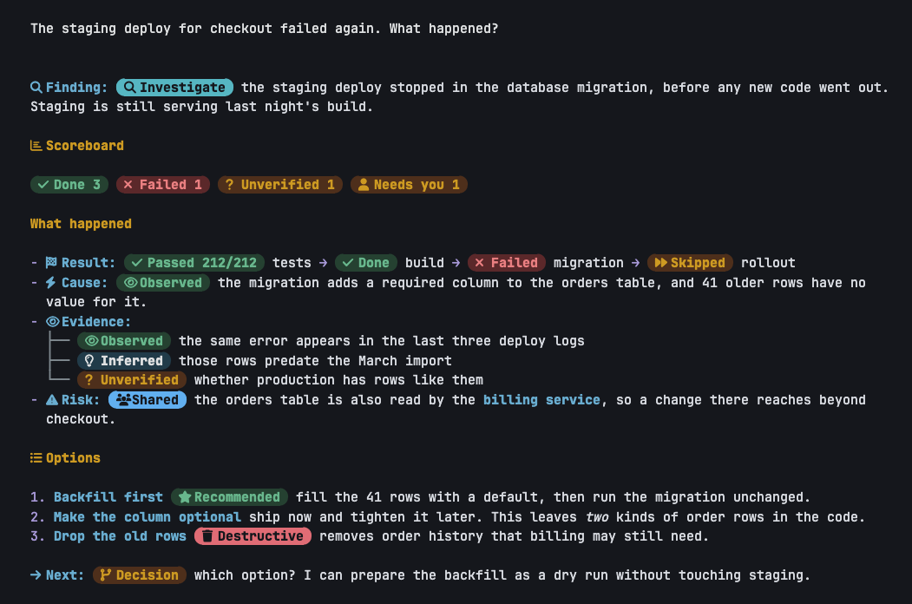
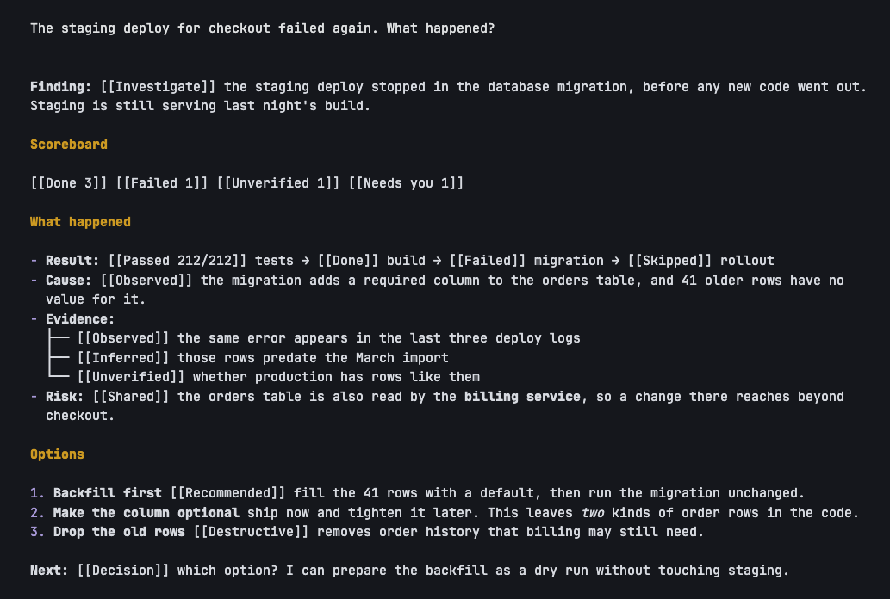

# Pi Emphasis

## This fork

This is a fork of [pi-emphasis](https://github.com/johnlindquist/pi-emphasis) by John Lindquist, at commit `f884b73`. The drawing code (pills, labels, lead-ins, marks, trees) comes from upstream. The fork differs in four ways:

- **Compact rules.** The `reply_style` prompt section is a short tested rule set of 310 tokens, in place of upstream's guidance of 2,419 tokens. In a test with the same prompts, it gave the same reply shape as upstream's guidance: a kind-of-work pill, `##` sections, and a pill right after each subject. The rules are the `REPLY_STYLE` constant in [`index.ts`](index.ts).
- **A new look.** Pill colors come from the current pi theme. All icons are circles of one size. Needs you and Decision are solid yellow, so they stand apart from status pills. A count line of the reply's pills appears under the first paragraph. [DESIGN.md](DESIGN.md) records each decision.
- **Settings.** An optional `emphasis` block in pi's `settings.json` sets the pill ends, the icons, the label color, and the color and fill of each tone. See [docs/configuration.md](docs/configuration.md).
- **No environment switches.** The four `PI_EMPHASIS_*` environment variables are gone. The rules are always on in the terminal interface.

Sync with upstream: the remote `upstream` points at the original repository.

```sh
git fetch upstream
git merge upstream/main
bun run check
```

Merge conflicts usually sit in the guidance and the switches; keep this fork's side there. The rest of this README is upstream's, corrected where the fork makes it false.

Replies you can scan. This [Pi](https://pi.dev/) extension turns `[[Done]]`, `[[Failed]]` and `[[Needs you]]` into colored pills with icons, gives headings and lead labels an icon from their word, and colors bold text, arrows and tree lines.



The reply above is an invented example about an imagined deploy. This is the same reply without the extension:



It changes only what is drawn. Stored messages, copied text and HTML exports keep the original Markdown. It calls no model and costs nothing to run.

## Requirements

| You need | Why | Without it |
|---|---|---|
| [Pi](https://github.com/earendil-works/pi) 1.5 or newer (checked on 1.5.0) | This is a Pi extension | It cannot be installed |
| A terminal that can draw [Nerd Font](https://www.nerdfonts.com/) symbols | The icons and the rounded pill ends are Nerd Font symbols | You see empty boxes or question marks. See [Set up your terminal](#set-up-your-terminal) |
| A terminal with color | Pills are colored backgrounds | Pills are drawn in reverse video, all in one color |
| `git` | `pi install` clones this repository | The install fails |

Checked on macOS only. Setup takes about two minutes if your terminal already has the symbols.

## Install

This fork has no public address. Install it from its local path:

```sh
pi install /path/to/pi-emphasis
```

Then run `/reload` in Pi, or start Pi again.

- Update: `git pull` in the fork, then `/reload`
- Try once without installing: `pi -e /path/to/pi-emphasis`
- Remove: `pi remove /path/to/pi-emphasis`

## Set up your terminal

**1. Check whether your terminal already draws the symbols.** Paste this into your shell:

```sh
printf '\ue0b6\U000f05e0 \U000f02d7 \U000f0009\ue0b4\n'
```

You should see a half circle, a check mark in a circle, a question mark in a circle, a person in a circle and another half circle. If you do, skip to step 3. Ghostty, kitty and WezTerm include these symbols, so they usually pass with any font.

**2. If you see boxes, install a Nerd Font and select it.** On macOS with Homebrew:

```sh
brew install --cask font-jetbrains-mono-nerd-font
```

Or download any family from [nerdfonts.com](https://www.nerdfonts.com/font-downloads). Then choose it as the terminal's font and run the check again:

| Terminal | Where the font is set |
|---|---|
| iTerm2 | Settings, Profiles, Text, Font |
| macOS Terminal | Settings, Profiles, Text, Font |
| VS Code terminal | the `terminal.integrated.fontFamily` setting, for example `JetBrainsMono Nerd Font` |
| Alacritty | `font.normal.family` in `alacritty.toml` |

To keep your current font, install only the symbols with `brew install --cask font-symbols-only-nerd-font` and add "Symbols Nerd Font" as a fallback font where your terminal supports one.

**3. Check it in Pi.** After installing the extension and running `/reload`, ask:

> Reply with one line that uses the pills [[Done]], [[Needs you]], [[Failed]] and [[Costs money]].

You should see four rounded pills, each with an icon: Done on a green panel, Needs you in solid yellow, Failed on a red panel and Costs money in solid red.

**No Nerd Font?** Set `"icons": "none"` and `"edges": "half"` or `"sharp"` in the `emphasis` settings ([docs/configuration.md](docs/configuration.md)). Half blocks are standard Unicode characters, so every terminal font draws them.

## The rules come with it

An agent writes pills only when it is told how. In Pi's terminal interface the extension adds a `reply_style` section to the system prompt on every run, so there is nothing to paste into an `AGENTS.md`. The section tells the agent:

- to open with **Result:**
- to open a long reply with a kind-of-work pill (Brainstorm, Investigate, Preview, Implement or Qualify) before **Result:**, to give it a `##` heading per group, and to write each bullet as **Subject** [[Pill]] text
- to use these pill words: Done, Passed, Fixed, Observed, Recommended, Failed, Blocked, Partial, In progress, Unverified, At risk, Needs you, Decision, Destructive, Costs money, Shared
- to follow a pill with the step that resolves it, led by a bold Do:, Check:, Next:, Unblock:, Left:, Guard:, Undo: or See:
- to put Costs money or Destructive once, before an action that waits for your approval, and to mention a cost only there or when it passes the amount you approved

The section is fixed text. A test checks that every kind, pill word and lead-in it names gets its color and icon, so the rules and the drawing cannot drift apart. It adds 310 tokens to the prompt, measured on claude-opus-5-5 (188 by tiktoken o200k_base). Print, JSON and RPC runs do not get the section, since nothing there draws pills.

## Pills

Write `[[Word]]` beside the thing it describes. The word decides the color and the icon.


| Color (default) | Tone | Meaning | Words |
|---|---|---|---|
| Red panel | error | Something is wrong | Failed, Blocked, Broken, Unsafe, Rejected, Down |
| Solid yellow | ask | Only you can act | Needs you, Decision |
| Yellow panel | warning | Look here | Unverified, Partial, Skipped, In progress, Pending, At risk, Review, Todo, Stale, Draft |
| Green panel | success | Settled | Done, Passed, Observed, Fixed, Live, Recommended, Keep, Ready, Merged, Safe, Verified, Shipped, Approved, Healthy |
| Solid red | danger | Consequences | Costs money, Destructive, Irreversible |
| Accent panel | mode | Kind of work | Brainstorm, Investigate, Preview, Implement, Qualify |
| Purple panel | owner | Ownership | Owned, Shared, Foreign |
| Grey panel | neutral | Context | Inferred, New, Changed, Optional, and any other label |

The colors come from the current pi theme, so `/theme` recolors the pills. [docs/configuration.md](docs/configuration.md) explains how to change the color, fill, ends and icons.

- **Detail.** A known word may be followed by detail: `[[Passed 12/12]]`, `[[Failed: 3 tests]]`, `[[In progress 40%]]`.
- **Synonyms.** Completed, Complete, OK and Finished display as Done. Fail, Failing and Error display as Failed. Pass displays as Passed, Waiting as Pending, and Needs review as Review.
- **Your own icon.** A label that starts with a Nerd Font glyph keeps that glyph.
- **Length.** A label can be up to 32 characters. Longer ones are left as typed.
- **Count line.** When a reply has 5 or more state pills of at least 2 words, a line under its first paragraph shows one pill per word with its count, asks first: [[Needs you 1]] [[Partial 1]] [[Done 4]]. The line appears when the reply is complete. A reply that already has a line of only pills gets no count line.

## Labels and shapes

- **Headings and lead labels.** A `##` heading, or bold text at the start of a line or list item (also after a kind-of-work pill), takes an icon when it is one of: Finding, Result, Status, Evidence, Cause, Effect, Fix, Risk, Limits, Cost, Decision, Options, Plan, Next, Why, How, Rule, Example, Checked, Verdict, Rollback, Undo, Review, Scoreboard, Terminal, Folder, File, Branch, Ideas, Pills, Colors, Icons. A trailing colon is fine.
- **Action lead-ins.** Bold **Check:**, **Do:**, **Next:**, **Unblock:**, **Left:**, **Run:**, **Guard:**, **Undo:** and **See:** take an icon anywhere in a line, so the action that follows a pill is easy to find: `[[Unverified]] the red pills on your screen. **Check:** run /reload.` The colon is required.
- **Bold.** `**anchor term**` keeps its weight and takes the label color: the theme's link color `mdLink` (blue in tokyonight), or the color in the `labels` setting.
- **Marks.** `✓` takes the success color, `✗` the error color, and `→` the accent color.
- **Trees.** `├──` and `└──` are dimmed so the content stands out.

Your own messages, inline code, fenced code and escaped asterisks are left alone. A `$` before a digit is drawn escaped, because pi's Markdown reads `$` as the start of LaTeX math and then prints the rest of the line as typed.

## Settings

Put an optional `emphasis` block in pi's `settings.json`, then run `/reload`. [docs/configuration.md](docs/configuration.md) describes each field, its values and its default.

| Field | Values | Default |
|---|---|---|
| `edges` | `round`, `half`, `sharp` | `round` |
| `icons` | `filled`, `outline`, `none` | `filled` |
| `labels` | a pi theme color name or `#rrggbb` | `mdLink` |
| `colors.<tone>` | a pi theme color name or `#rrggbb` | the theme's success, error, warning, accent and other colors |
| `fill.<tone>` | `panel`, `solid`, `text` | `solid` for ask and danger, `panel` for the rest |

```json
{ "emphasis": { "edges": "sharp", "icons": "outline", "labels": "mdHeading", "colors": { "ask": "#ff966c" } } }
```

To add a word, an icon or a synonym, edit the tables at the top of [`index.ts`](index.ts). The rules are the `REPLY_STYLE` constant in the same file.

## Troubleshooting

| You see | Cause | Fix |
|---|---|---|
| `[[Done]]` as plain text | The extension is not loaded | Run `/reload`. Check that `pi list` shows pi-emphasis |
| Boxes or question marks in or around pills | The terminal has no Nerd Font symbols | [Set up your terminal](#set-up-your-terminal) |
| Icons that overlap the next letter | The font draws its icons wider than one cell | Use the "Mono" variant of the Nerd Font, such as JetBrainsMono Nerd Font Mono. Its icons are smaller |
| Small icons | A "Mono" Nerd Font puts every icon in one cell, and terminals other than Ghostty keep an icon in one cell | In Ghostty, use the font's non-Mono variant: the icon then grows over the en space after it. `adjust-icon-height` in the Ghostty config makes icons taller still |
| Pills that are all one color, in reverse video | The terminal draws no truecolor, or pi's theme has no panel colors (the `system` theme when the terminal reports none) | Choose a theme with `/theme`, such as `dark`, in a truecolor terminal |
| Pills in colors you do not want | The colors come from the pi theme | Set `colors` and `fill` in the [settings](docs/configuration.md) |
| Bold that looks no heavier than normal text | The terminal draws normal text at a medium weight, or its font has no real bold | Choose a font with a distinct bold. In Ghostty, `font-style-bold` selects a heavier face |
| The agent writes no pills | The rules reach the agent only in Pi's terminal interface | Use the terminal interface. Print, JSON and RPC runs never get the rules |
| Pills inside code blocks stay as typed | Code is left alone on purpose | Nothing to fix |

## Limits

- A bold span that continues onto a second source line is colored only on its first line.
- Checked on macOS only, in Ghostty and the Herdr app.

## Development

```sh
bun install
bun run check                # types and tests, including Hegel property tests
python3 demo/shots.py        # redraw the demo replies in a real Pi session, as HTML to screenshot
```

`demo/` holds the two example replies. `sgr-sampler.sh` prints every terminal text style so you can see which ones your terminal draws.
